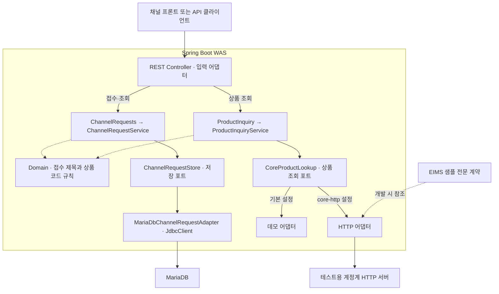

# 채널 백엔드 헥사고날 PoC

Java 17 이상, Spring Boot 4.1.2, Gradle Wrapper를 사용하는 단일 프로젝트입니다. [CHSBackPOCV1](https://github.com/zx10185252/CHSBackPOCV1)의 샘플 API와 전문 형식을 참고해 독립적으로 구현했습니다.

## 구조



| 기능 | 입력 포트 | 서비스 | 출력 포트 | 구현 어댑터 |
|---|---|---|---|---|
| 상품 조회 | `ProductInquiry` | `ProductInquiryService` | `CoreProductLookup` | 데모 데이터 또는 계정계 HTTP |
| 요청 접수·조회 | `ChannelRequests` | `ChannelRequestService` | `ChannelRequestStore` | MariaDB / JdbcClient |

`product`, `request` 패키지 아래에 각각 `domain`, `application`, `adapter`가 있습니다. Domain은 상품 코드 형식과 접수 제목의 규칙을 정의합니다. Application은 도메인 모델을 사용하고 외부 작업을 자신이 정의한 출력 포트에 요청합니다. Spring은 `config/ChannelConfiguration`에서 포트와 구현체를 연결합니다.

채널 DTO와 EIMS 샘플 전문은 각 어댑터에서 변환합니다. 추후 은행의 MCI 연계 계약이 확정되면 `CoreProductLookup`을 구현하는 어댑터에 전문 변환과 통신을 넣고 설정에서 연결할 수 있습니다. [EIMS 샘플 계약](docs/eims/CHS-CORE-001-v1.0.json)의 필드와 결과 코드는 가상의 PoC 값입니다.

## 실행

로컬 Docker Compose에서 MariaDB 11.8을 실행한 뒤 Spring Boot를 시작합니다.

```sh
export DB_PASSWORD='replace-with-a-local-password'
docker compose up -d --wait
./gradlew bootRun
```

기본 API 주소는 `127.0.0.1:8080`이고 DB는 `127.0.0.1:3306/chs_poc`, 사용자는 `chs`입니다. 각각 `SERVER_PORT`, `DB_PORT`, `DB_NAME`, `DB_USERNAME`으로 변경합니다. 사용할 포트와 DB 계정 설정은 Compose를 실행하기 전에 지정합니다. Compose는 볼륨을 처음 초기화할 때 계정과 [테이블](src/main/resources/db/mariadb/schema.sql)을 생성하며 이후에도 데이터를 보존합니다.

이미 운영 중인 MariaDB는 `DB_URL`에 `jdbc:mariadb://호스트:3306/DB이름`을 지정하고 `DB_USERNAME`과 `DB_PASSWORD`를 설정해 연결합니다. [DDL](src/main/resources/db/mariadb/schema.sql)은 대상 DB에 사전 적용합니다. 이전 PoC의 SQLite 파일을 사용했다면 필요한 데이터는 별도로 이관합니다.

`./gradlew test`는 Docker를 사용해 독립된 테스트용 MariaDB 컨테이너에 스키마를 적용합니다. 최초 빌드는 Gradle과 Maven 의존성을 내려받습니다.

### 요청 접수·조회

```sh
curl -i http://127.0.0.1:8080/api/v1/channel-requests \
  -H 'Content-Type: application/json' \
  --data '{"subject":"채널 POC 요청"}'
```

응답은 `201 Created`이며 본문에 UUID, 제목, 상태, 생성 시간이 포함됩니다. `Location` 헤더의 경로를 GET으로 조회하면 저장된 요청을 확인할 수 있습니다. 공백 또는 120자를 초과하는 제목과 잘못된 UUID는 `400`, 존재하지 않는 UUID는 `404`입니다. `RECEIVED`는 MariaDB에 접수 기록이 저장됐다는 뜻입니다. 생성 시간은 UTC 기준으로 마이크로초까지 저장합니다.

### 상품 조회

기본 프로필은 `SAMPLE-DEPOSIT` 샘플 상품을 반환합니다.

```sh
curl -i http://127.0.0.1:8080/api/v1/core/product-inquiries \
  -H 'Content-Type: application/json' \
  --data '{"productCode":"SAMPLE-DEPOSIT"}'
```

샘플 계약을 제공하는 계정계 HTTP 스텁이 있다면 같은 채널 API를 다음 설정으로 실행합니다.

```sh
SPRING_PROFILES_ACTIVE=core-http CORE_BASE_URL=http://127.0.0.1:8091 ./gradlew bootRun
```

HTTP 어댑터의 접속 및 응답 타임아웃은 `CORE_CONNECT_TIMEOUT_MS` 및 `CORE_READ_TIMEOUT_MS`로 설정합니다. 채널 API는 정상 조회 `200`, 상품 없음 `404`, 계정계 연결 실패·응답 계약 불일치 `502`, 타임아웃 `504`를 반환합니다. `CoreHttpProfileTest`는 로컬 스텁을 띄워 HTTP 어댑터 선택, 전문 전송 및 채널 응답 변환을 확인합니다.
